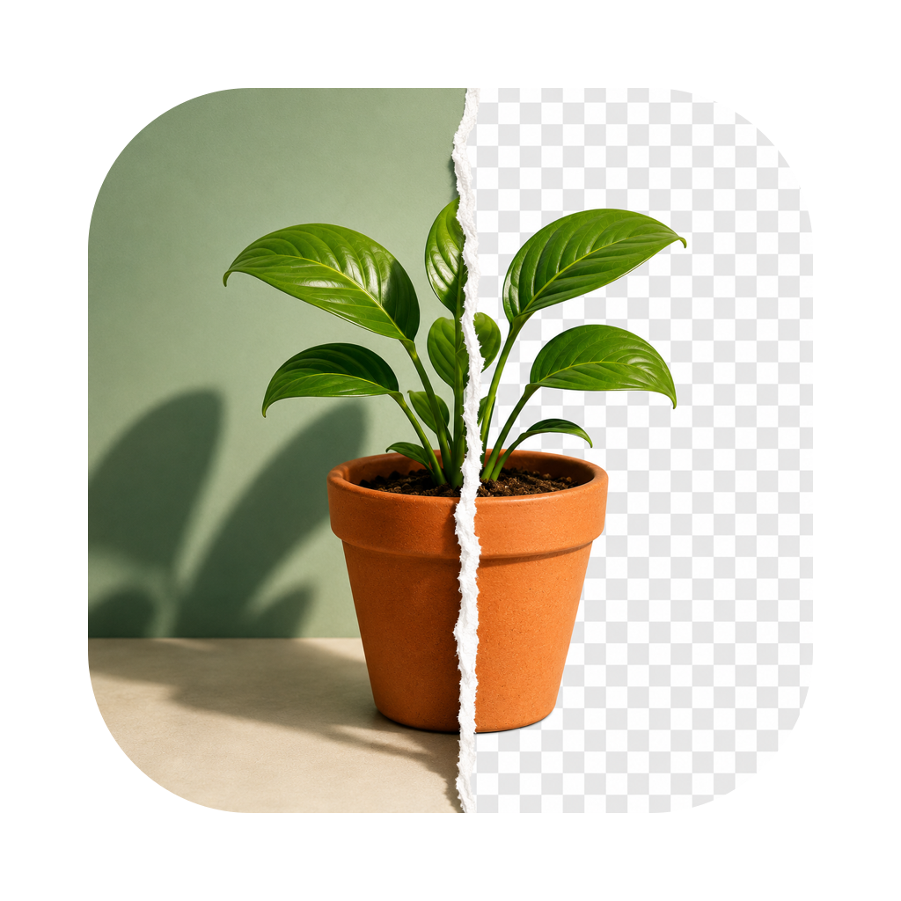

<div align="center">
	
	<h1>Background Remover</h1>
	<p>
		  <b>Remove image backgrounds on your Mac — locally, with one click</b>
	</p>

[](https://x.com/cypher_poet) [](https://www.paypal.com/ncp/payment/L6M553P28YPDY) [](https://cash.app/$CypherPoet) [](https://buymeacoffee.com/cypherpoet) [](https://github.com/CypherPoet/Image-Background-Remover/blob/main/LICENSE)

	<br>
	<br>
	<br>
</div>

A native macOS app that removes the background from an image with one click. It's a SwiftUI front end for [`rembg`](https://github.com/danielgatis/rembg), which runs ONNX segmentation models **locally** — your images never leave your Mac.

- Drag in an image (or ⌘O), pick a model, click **Remove Background**.
- See the cutout on a transparency checkerboard, flip between original and result.
- Keep the background transparent, or fill it with white or any color.
- Refine fuzzy edges (hair, fur) with alpha matting.
- Save as PNG (⌘S) or drag the result straight into Finder or another app.

## Requirements

- macOS 14 (Sonoma) or later
- Xcode or the Command Line Tools (`xcode-select --install`) — needed to build
- [`rembg`](https://github.com/danielgatis/rembg) with CLI extras:
  ```bash
  pip install "rembg[cli]"
  ```
  The installer offers to do this for you.

## Install

```bash
git clone https://github.com/CypherPoet/Image-Background-Remover.git
cd Image-Background-Remover
./install.sh
```

`install.sh` checks for `rembg` (offering to install it), builds the app from source, and copies it to `/Applications`. Launch it from Spotlight afterward.

Options:

```bash
./install.sh --universal     # build a universal (Apple Silicon + Intel) binary
./install.sh --to ~/Applications   # install somewhere other than /Applications
```

To remove it:

```bash
./uninstall.sh
```

## Choosing a model

The app exposes the most useful of `rembg`'s models, grouped by subject. The right model depends on what you're cutting out — using the wrong one produces broken results.

| Subject                           | Use                                                         |
| --------------------------------- | ----------------------------------------------------------- |
| People, headshots                 | **BiRefNet Portrait** (quality) or **U²-Net Human** (speed) |
| Products, animals, general scenes | **BiRefNet General** (quality) or **U²-Net** (speed)        |
| Hair, fur, plants, glass          | **BiRefNet Dichotomous** + alpha matting                    |
| Flat 2D / anime art               | **IS-Net Anime** (not for photoreal CGI)                    |
| Clothing                          | **U²-Net Clothing**                                         |
| Large batches                     | **U²-Net Lite** or **Silueta**                              |

The first time you use a given model, `rembg` downloads its weights (50–400 MB) to `~/.u2net/`. That first run is slow; later runs reuse the cache.

## How it works

```
SwiftUI UI  ──>  AppModel  ──>  RembgService  ──>  rembg CLI  ──>  transparent PNG
```

- **`RembgService`** locates the `rembg` binary (checking common install paths, then your login shell's `PATH`), runs it via `Process`, and maps failures to actionable errors — a missing `filetype` module, a failed model download, a wrong-model result.
- **`AppModel`** (an `@Observable` `@MainActor` type) owns the session state and builds each `RemovalRequest`.
- The segmentation runs off the main thread; the UI shows progress and never blocks.

If the app can't find `rembg`, it shows a banner with a link to **Settings**, where you can set an explicit path (useful for virtualenvs).

## Building from source

No Xcode project is needed — the app is compiled directly with `swiftc`:

```bash
./build.sh              # builds build/Background Remover.app for your Mac
./build.sh --universal  # universal binary
```

The sources live in [`app/Sources`](app/Sources):

| Path                          | Role                                                  |
| ----------------------------- | ----------------------------------------------------- |
| `BackgroundRemoverApp.swift`  | App entry, window, menu commands                      |
| `ContentView.swift`           | Main layout, toolbar, importer/exporter, error alerts |
| `State/AppModel.swift`        | Observable session state and orchestration            |
| `Services/RembgService.swift` | Locates and runs the `rembg` CLI                      |
| `Models/`                     | Model catalog, background mode, request definition    |
| `Views/`                      | Drop zone, preview, options panel, settings           |

## License

MIT — see [LICENSE](LICENSE).

Background removal is powered by [rembg](https://github.com/danielgatis/rembg) by Daniel Gatis.
